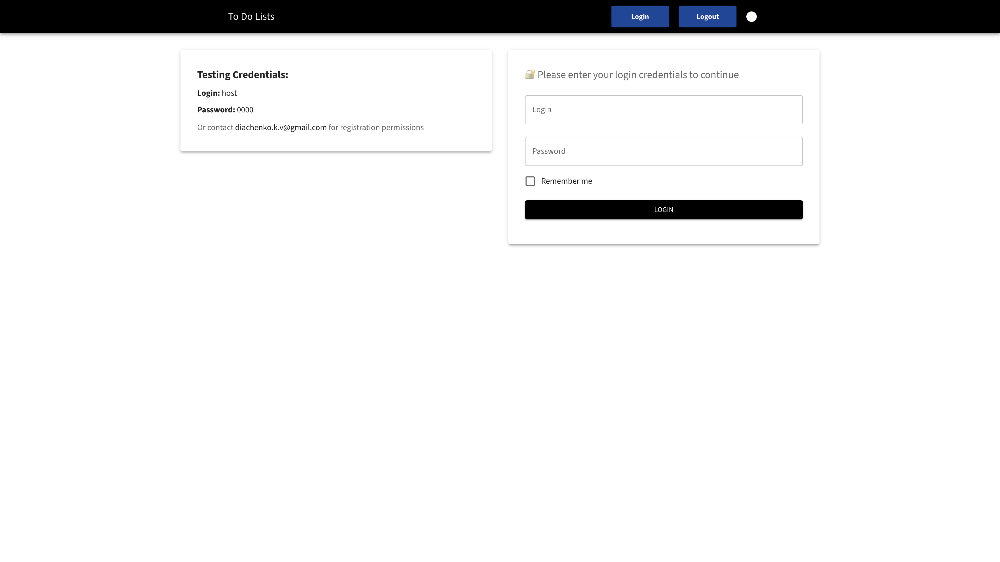
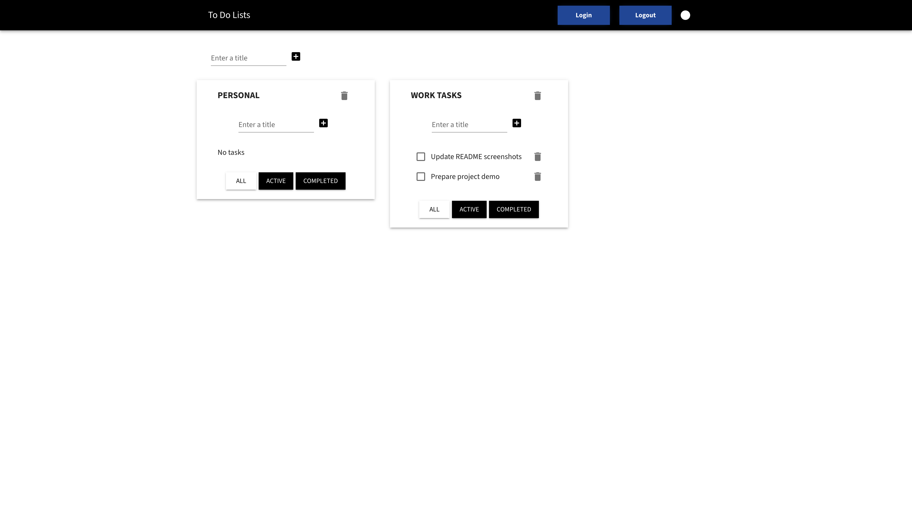

# To Do Lists

React + TypeScript todo app backed by WordPress (JWT auth & custom REST API).

## Screenshots

### Login



### Todolists



## Quick start

### Prerequisites

- Node.js
- Docker (WordPress + MySQL on ports `8080` / DB)

### Backend

From the repo root:

```bash
docker compose up -d db wordpress
```

WordPress API: [http://localhost:8080](http://localhost:8080)

### Frontend

```bash
cd react-app
npm install
npm start
```

App: [http://localhost:3000](http://localhost:3000)

Demo credentials (also shown on the login page):

- **Login:** `host`
- **Password:** `0000`

## Available scripts

| Script | Description |
| --- | --- |
| `npm start` | Dev server at [http://localhost:3000](http://localhost:3000) |
| `npm test` | Interactive test runner |
| `npm run build` | Production build to `build/` |
| `npm run deploy` | Build and publish to GitHub Pages |
| `npm run storybook` | Storybook on port `6006` |

## Stack

- React 18, TypeScript, Redux Toolkit
- MUI + Emotion
- React Hook Form + Zod
- WordPress REST API + JWT authentication
